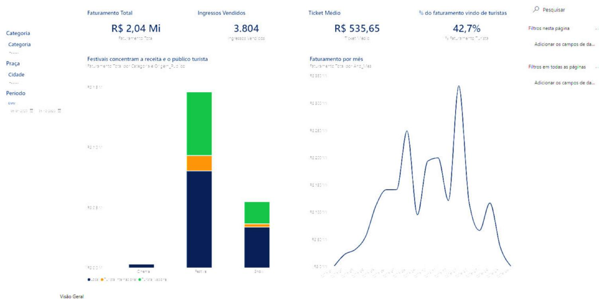
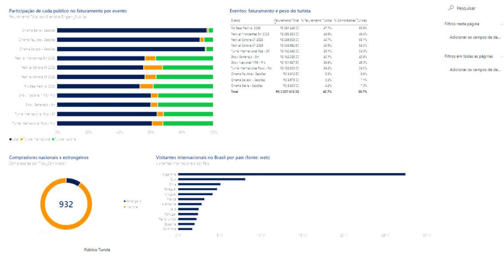
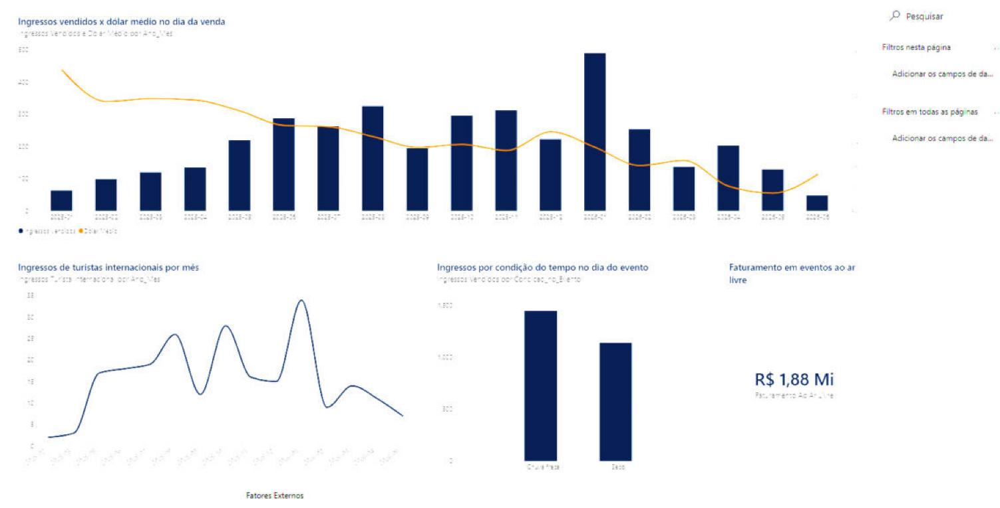

# 04-powerbi-dashboard · Etapa 6: Dashboard Power BI

**Arquivo principal:** `IngressoData_Dashboard.pbix` (3 páginas, montado e atualizado no Power BI Desktop em 22/11/2026).

| Arquivo | Conteúdo |
|---|---|
| `IngressoData_Dashboard.pbix` | Dashboard final com os dados já carregados |
| `IngressoData_Dashboard.pbip` + pastas `.Report` e `.SemanticModel` | O mesmo relatório em formato de projeto (texto): modelo em TMDL e visuais em JSON, bom para versionar no Git |
| `prints/` | Captura de cada página |
| `IngressoData_tema.json` | Tema de cores aplicado ao relatório |

O projeto é gerado por `04-documentacao/scripts/build_pbip.py` a partir das próprias consultas `.pq` (Power Query e APIs) e das medidas de `medidas.dax`, com 3 medidas a mais: Dólar Médio, Ingressos Turista Internacional e Visitantes Internacionais.

### Conferência (bate com o gabarito)

Faturamento Total R$ 2,04 mi (R$ 2.037.612,50) · Ingressos 3.804 · Ticket Médio R$ 535,65 · % Faturamento Turista 42,7%.

### Para atualizar em outro computador

1. Abra o `.pbix` e vá em **Transformar dados > Editar parâmetros**: aponte `pPastaDados` para a pasta `01-excel/dados-brutos` do seu computador (terminando com `\`).
2. **Atualizar**. Na primeira vez, escolha acesso **Anônimo** para Wikipédia, Banco Central e Open-Meteo, e nível de privacidade **Público** para todas as fontes.

## Montagem manual (referência)

1. **Obter Dados > Excel** e carregar o modelo, ou colar as consultas `.pq` em **Transformar Dados > Nova Fonte > Consulta Nula** (mesmos nomes do Excel).
2. Criar os 4 relacionamentos (ver `03-powerpivot`) e marcar `Dim_Calendario` como tabela de data.
3. Colar as medidas de `medidas.dax` em **Nova Medida**.
4. **Exibir > Temas > Procurar temas** e escolher `IngressoData_tema.json`.
5. Salvar como `IngressoData_Dashboard.pbix` nesta pasta.

## Páginas

**1. Visão Geral**
- Cartões: Faturamento Total, Ingressos Vendidos, Ticket Médio, % Faturamento Turista
- Colunas empilhadas: Faturamento por Categoria × Origem_Publico
- Linha: Faturamento por Dim_Calendario[Ano_Mes]
- Segmentações: Categoria, Praça, Período (Dim_Calendario[Data], entre)

**2. Público Turista** (pergunta central)
- Barras 100% empilhadas: Origem_Publico por Evento
- Mapa (Dim_Praca Latitude/Longitude): bolha = Faturamento Turista
- Tabela: Evento, Faturamento, % Faturamento Turista, % Compradores Turistas, com formatação condicional
- Rosca: Compradores por Dim_Comprador[Tipo_Comprador]

**3. Fatores Externos** (após a Etapa 5)
- Linha com eixo duplo: Ingressos Vendidos e média de Dolar_no_Dia_da_Venda por Ano_Mes
- Dispersão: dólar × ingressos de Turista Internacional por mês
- Colunas: Ingressos em eventos ao ar livre por Condicao_no_Evento
- Cartão: Faturamento Ao Ar Livre

## Regras visuais

- Cores fixas por significado: Local = azul escuro, Turista Nacional = laranja, Turista Internacional = verde. Usar as mesmas cores em todas as páginas.
- No máximo 6 visuais por página; cartões no topo, detalhe embaixo, segmentações à esquerda.
- Títulos dizem a conclusão ("Festivais: 45% da receita vem de turistas"), não só o nome do gráfico.
- Rótulos de dados em reais sem casas decimais; percentuais com 1 casa.
- Contraste mínimo 4,5:1 entre texto e fundo (o tema já respeita).
