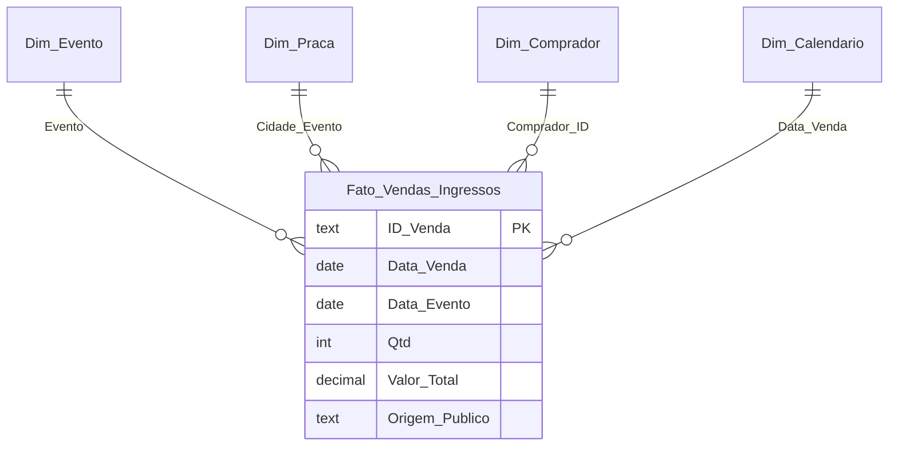

# IngressoData Brasil

Projeto Evolutivo de **Microinformática Aplicada (ILP590)**, FATEC SP, Prof. Veríssimo, 2º/2026.

Plataforma de inteligência de dados para venda de ingressos e turismo de eventos. Pergunta central:

> Qual a participação do público turista no faturamento de ingressos por tipo de evento, e como a cotação do dólar e o clima influenciam o volume de vendas e o ticket médio ao longo do tempo?

## Equipe

| RA | Nome | Papel |
|---|---|---|
| 20482623085 | Eudócio Vicente Silva Washimi | Engenharia de Dados / Excel |
| 20482522044 | Rafael Oliveira dos Santos | Modelagem Power Query / DAX |
| 20482623086 | Enrico Yuri Florencio de Oliveira | Automação VBA & APIs |
| 20482413002 | Amanda Veloso Rodrigues | Banco de Dados SQL / Power BI |
| 20482623092 | Jean Amaral da Silva | Programador API |

## Pipeline

Dado Bruto → Excel Avançado → Power Query → Power Pivot/DAX → VBA → SQL → API/Web → Power BI

## Estrutura

```
MA2026-projeto-pratico/
├── MA2026-entrega-parcial/
│   ├── 01-excel/          planilha tratada por fórmulas (PROCX, VALORNUMERO) + dados brutos
│   ├── 02-powerquery/     consultas M (.pq) que automatizam a mesma limpeza
│   ├── 03-powerpivot/     Star Schema, medidas DAX e gabarito de conferência
│   └── 04-documentacao/   relatório parcial, dicionário de dados, roteiro e legenda do vídeo
└── MA2026-entrega-final/
    ├── 01-vba/                 macros de relatório diário/semanal (.bas)
    ├── 02-bancodedados-sql/    DDL, carga e consultas (SQLite e PostgreSQL)
    ├── 03-api-web/             câmbio (BCB/PTAX) e clima (Open-Meteo)
    └── 04-powerbi-dashboard/   especificação do painel e tema do Power BI
```

## Modelo dimensional (Star Schema)



## Resultados (base simulada, 2.000 vendas válidas)

| Categoria | Faturamento | Ingressos | Ticket médio | % faturamento turista | Participação |
|---|---:|---:|---:|---:|---:|
| Festival | R$ 1.460.022,50 | 1725 | R$ 846,39 | 45,0% | 71,7% |
| Show | R$ 548.412,50 | 1155 | R$ 474,82 | 38,8% | 26,9% |
| Cinema | R$ 29.177,50 | 924 | R$ 31,58 | 6,0% | 1,4% |
| **Total** | **R$ 2.037.612,50** | **3804** | **R$ 535,65** | **42,7%** | **100%** |
Os mesmos números saem do Excel (fórmulas), do Power Query/DAX e do SQL. O gabarito completo está em `MA2026-entrega-parcial/03-powerpivot/gabarito.json`.

## Dados

Todos os dados de vendas são **simulados** por um gerador com semente fixa (`04-documentacao/scripts/gerar_dados_simulados.py`). Eventos, locais e compradores são fictícios. Câmbio e clima vêm de APIs públicas reais.
